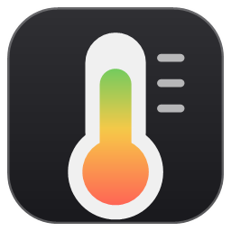
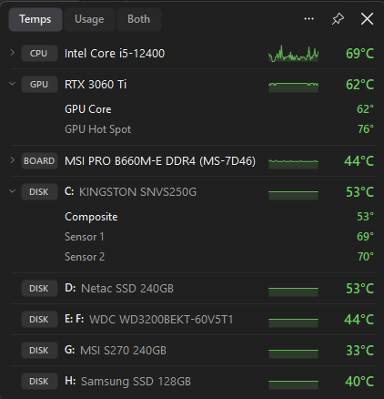
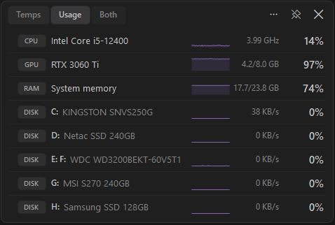

<p align="center">
  
</p>

<h1 align="center">AllTemp: CPU, GPU, SSD &amp; RAM temperature monitor for Windows</h1>

<p align="center">
  <b>Every temperature on your PC in one small, always-on-top overlay.</b><br>
  Free and lightweight for Windows 11 and Windows 10. CPU, GPU, NVMe/SSD/HDD, RAM and motherboard temperatures, plus CPU/GPU/RAM usage, in one window you can pin over games and apps.
</p>

<p align="center">
  <a href="https://github.com/Imtiaj-Sajin/all-temp/releases/latest/download/AllTemp-Setup.exe"></a>
</p>

<p align="center">
  <a href="https://github.com/Imtiaj-Sajin/all-temp/releases/latest"></a>
  <a href="https://github.com/Imtiaj-Sajin/all-temp/releases"></a>
  
  <a href="https://imtiaj-sajin.github.io/all-temp/"></a>
</p>

<p align="center">
  
  
</p>

## Why AllTemp?

Windows has no built-in way to see your CPU temperature, SSD temperature or GPU hot spot. Tools like HWMonitor and HWiNFO show hundreds of sensors in a big table. AllTemp shows **just the temperatures that matter, one row per device**, in a small dark overlay you can **pin on top of any window** (like the Xbox Game Bar performance widget) while you game, render or compile.

- 🌡️ **All temperatures in one place:** CPU package and every core, each GPU (core + hot spot), every NVMe / SATA SSD and hard drive (labelled with its drive letters C:, D:, …), motherboard / VRM / chipset, RAM sticks with sensors, and AIO liquid temperature.
- 📌 **Pin on top:** always-on-top overlay with adjustable transparency and optional click-through.
- 📊 **Usage too:** switch between **Temps | Usage | Both**: CPU load and clock speed, GPU load and VRAM, RAM used/total, disk activity and transfer rate, each with a 60-second graph.
- 🟢🟡🔴 **Colour-coded warnings** per device type. NVMe drives use their own reported warning temperature.
- 🔔 **Live CPU temperature in the system tray**; the tooltip lists every device.
- 🪶 **Lightweight:** ~40 MB RAM and ~0.2 % CPU at a 1-second refresh. A 6.6 MB installer.
- 🌗 °C / °F, refresh rate, start with Windows, compact mode. Right-click for everything.

## Download

| | |
|---|---|
| ⬇️ **[AllTemp-Setup.exe](https://github.com/Imtiaj-Sajin/all-temp/releases/latest/download/AllTemp-Setup.exe)** (recommended) | Installs AllTemp with a Start menu entry. Optionally installs the sensor driver and starts with Windows, and downloads the Microsoft .NET 8 Desktop Runtime only if it's missing. |
| ⬇️ **[AllTemp-portable.exe](https://github.com/Imtiaj-Sajin/all-temp/releases/latest/download/AllTemp-portable.exe)** | No install, just run it. Needs the [.NET 8 Desktop Runtime](https://dotnet.microsoft.com/download/dotnet/8.0). |

All versions: [Releases](https://github.com/Imtiaj-Sajin/all-temp/releases). Requirements: Windows 10 or 11 (64-bit).

> **"Windows protected your PC"?** AllTemp isn't code-signed yet, so SmartScreen may warn on first run. Click **More info → Run anyway**. The source code is all here, and the release files are built from it.

## FAQ

<details>
<summary><b>How do I check my CPU temperature on Windows 11 or 10?</b></summary>

Windows doesn't show it anywhere. Install AllTemp and the first row shows your CPU package temperature (click it for every core). The tray icon shows it as a live number, so you can see it without opening anything.
</details>

<details>
<summary><b>How do I check my SSD / NVMe or hard drive temperature?</b></summary>

AllTemp lists every drive with its drive letters (C:, D:, …) and temperature, read from the drive's SMART data. Click an NVMe drive to see all its sensors: "Composite" is the drive's overall temperature, and the extra sensors are usually the controller chip, which normally runs hotter.
</details>

<details>
<summary><b>What temperature is too hot?</b></summary>

AllTemp colours each value green, amber or red with limits per device type: CPU 70 / 85 °C, GPU core 75 / 85 °C, GPU hot spot 85 / 100 °C, NVMe 60 / 70 °C (or the drive's own warning temperature), NVMe controller 70 / 80 °C, SATA SSD 55 / 70 °C, hard drive 45 / 55 °C, motherboard and RAM 60 / 80 °C.
</details>

<details>
<summary><b>Can I keep temperatures on screen while gaming?</b></summary>

Yes. Click the 📌 pin and AllTemp stays on top of other windows with adjustable transparency. Turn on click-through so clicks pass through to the game, or compact mode to hide the header.
</details>

<details>
<summary><b>Why does it need administrator rights and a driver?</b></summary>

Windows only lets admin programs read disk SMART data and low-level hardware sensors. CPU, RAM and motherboard sensors also need a kernel driver, the same reason HWMonitor, CPU-Z and HWiNFO ship one. AllTemp uses the free, signed, open-source <a href="https://pawnio.eu">PawnIO</a> driver (also used by LibreHardwareMonitor and FanControl). Setup has it ticked by default, and you can untick it: GPU and disk temperatures still work without it.
</details>

<details>
<summary><b>How is this different from HWMonitor, HWiNFO or Core Temp?</b></summary>

Those are excellent but show everything in a large table, and Core Temp shows the CPU only. AllTemp is a small overlay focused on one question, "how hot is everything right now?", with every device on one screen, pin-on-top and a live tray icon. It uses the same open-source sensor library as LibreHardwareMonitor.
</details>

<details>
<summary><b>Does it support AMD CPUs and GPUs?</b></summary>

Sensors are read with <a href="https://github.com/LibreHardwareMonitor/LibreHardwareMonitor">LibreHardwareMonitor</a>, which supports Intel and AMD (Ryzen) CPUs, NVIDIA, AMD and Intel Arc GPUs, NVMe/SATA drives and most motherboard sensor chips. If something on your PC is missing, please <a href="https://github.com/Imtiaj-Sajin/all-temp/issues">open an issue</a> with the output of <code>AllTemp.exe --dump sensors.txt</code>.
</details>

## Sensor driver (PawnIO)

`AllTemp.exe` includes the official, signed [PawnIO](https://pawnio.eu) installer (v2.2.0, by namazso), so nothing needs to be downloaded separately.

- The installer has a ticked "Install the PawnIO sensor driver" option. With the portable exe (or if you unticked it), AllTemp asks once on first launch instead. **Yes** installs it silently and carries on. **No** is remembered, and the window and right-click menu keep an install link.
- Uninstall it any time from *Settings → Apps → PawnIO*.
- The installer is embedded unmodified, as its license allows. PawnIO is GPL-2.0; source code at <https://github.com/namazso/PawnIO>. The build downloads it from the official release and checks its SHA-256 hash.

## Build from source

```powershell
.\build.ps1
```

Needs the .NET 8 SDK and [Inno Setup 6](https://jrsoftware.org/isinfo.php) (`winget install JRSoftware.InnoSetup`). Writes `AllTemp-Setup.exe` and `AllTemp-portable.exe` to `dist\`. The installer script is `installer\AllTemp.iss`.

For UI work without the UAC prompt: `dotnet build -p:DevNoAdmin=true` (CPU/disk temps will be missing).

### Diagnostics

`AllTemp.exe --dump sensors.txt` writes every hardware node and sensor LibreHardwareMonitor sees. Settings live in `%AppData%\AllTemp\settings.json`; errors go to `%AppData%\AllTemp\error.log`. "Start with Windows" creates a Task Scheduler logon task named `AllTemp` (so an admin app starts without a UAC prompt).

### Code

| File | Purpose |
|---|---|
| `src/SensorService.cs` | Opens LibreHardwareMonitor, polls on a background thread, collects temperatures and usage, emits snapshots |
| `src/OverlayForm.cs` | Custom-painted window, views, pin mode, tray icon, menu |
| `src/TrayIcon.cs` | Renders the temperature number as the tray icon |
| `src/Native.cs` | Win32 bits: click-through, rounded corners, drive letter → physical disk mapping, PawnIO check |
| `src/Autostart.cs` | Task Scheduler logon task |
| `src/DriverSetup.cs` | Silent install of the bundled PawnIO driver |

Sensor access is via [LibreHardwareMonitorLib](https://github.com/LibreHardwareMonitor/LibreHardwareMonitor) (MPL-2.0).

---

<sub>Keywords: CPU temperature monitor, GPU temperature, SSD temperature, NVMe temperature, hard drive temperature, RAM temperature, motherboard temperature, Windows 11 temperature overlay, always on top, system tray CPU temp, hardware monitor, PC temperature checker.</sub>
